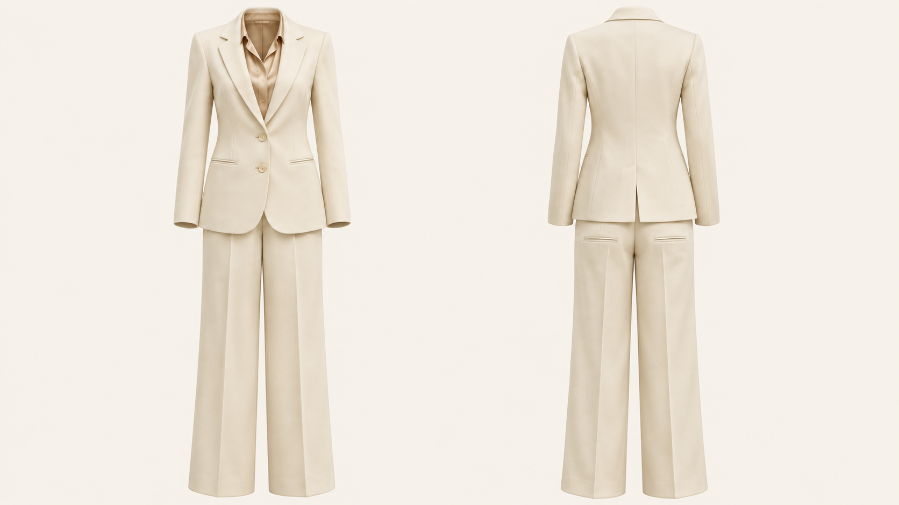
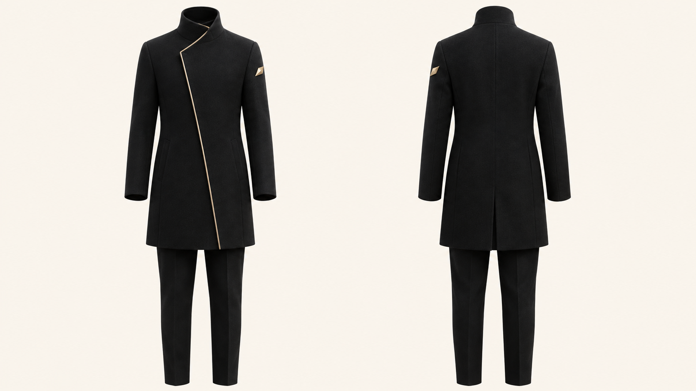
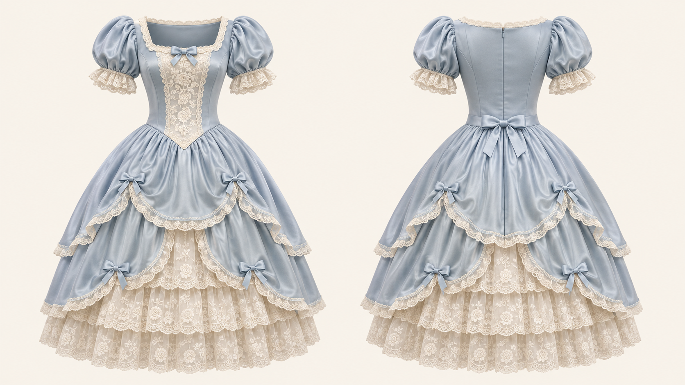

# OutfitTwin｜衣装の正面・背面再構成
### 参考画像からコーディネート全体を再構成し、1枚の画像で前後を表示

[English](README.md) · [简体中文](README.zh-CN.md) · [日本語](README.ja.md)

**OutfitTwin** は、**FuturEvoLab** が公開する、指示文ベースのオープンソース Agent Skill です。着用写真などを参考に衣装を再構成し、標準では**16:9の横長画像1枚に、左側に正面、右側に同じ衣装の背面**を表示します。

ゴーストマネキン撮影のように、衣服の自然な立体感を保ちながら、人物やマネキン、支持具を表示せず、暖かみのあるアイボリー背景に仕上げます。

> **公開状況：初版の指示文リリース。** モデルの重み、APIクライアント、画像生成サービスは含みません。画質は実行環境の画像モデルと参考資料に依存します。画像品質のベンチマーク実施は表明していません。

## AI生成サンプルギャラリー

2026-11-03に内蔵画像生成ツールで作成したオリジナルのコンセプト例です。正面・背面の表示形式を示すもので、参考写真からの抽出精度を検証したものではありません。元画像は1672 × 941ピクセル（ほぼ16:9）で、リサイズ・トリミングせず収録しています。ツールは正確なバックエンドモデル名を返していません。[プロンプトと確認記録](examples/README.md)。

### アイボリーのテーラードスーツ



### ブラック＆ゴールドの非対称コート



### パウダーブルーのロココ調ドレス



## 主な特徴

| 機能 | 方針 |
| --- | --- |
| コーディネート全体の再構成 | アウター、インナー、ボトムス、関連アクセサリーの重なりを維持します。 |
| 正面・背面で共通の構造 | 丈、寸法、素材、接合関係を先に定め、同一衣装の2視点を作成します。 |
| 根拠に応じた補完 | 視認できる情報、構造の延長、推定による新規設計を区別します。 |
| 上半身画像への対応 | ワンピース等の連続構造を延長し、必要に応じて調和するボトムスを補います。 |
| 非対称デザインの維持 | 衣服自体の左右を基準に追跡し、正面の反転画像を背面として使いません。 |
| 局所的な修正 | 正しい部分を維持し、誤りのある視点や領域を優先して修正します。 |

## 標準出力

- 横長 **16:9** の画像1枚、全体が見える2視点のみ。
- 左側は真正面、右側は**同じ衣装**の真後ろ。
- 表示倍率、上下位置、カメラ条件、照明を統一。
- 背景は **#F7F4EC** に近い、均一な暖色系アイボリー。
- 人物、マネキン、ハンガー、台座、追加ラベル、透かしは表示しません。
- 元の衣服にある判読可能な文字は維持し、正面限定の柄を背面に複製しません。

出力は**立体的に見える2D画像**です。3Dメッシュ、型紙、製造仕様書ではありません。

## 使い方

### 画像編集機能のあるアシスタントで使用する

1. [SKILL.md](SKILL.md) をアシスタントへの指示として渡すか、実行環境が対応する方法でSkill全体を導入します。
2. 衣装の参考画像を添付します。背面画像があれば、併せて提供してください。
3. 次のように依頼します。

> OutfitTwinでこの衣装全体を抽出・再構成してください。16:9の画像1枚に、左は正面、右は背面。人物なし、暖かみのあるアイボリー背景。見えているデザインを維持し、見えない部分は控えめに補完してください。

4. [品質チェックリスト](references/quality-checklist.md)で確認し、問題があれば該当部分の修正を依頼します。

Markdownファイルを渡すだけで、画像生成機能が追加されるわけではありません。テキストのみの環境では、英語の画像編集プロンプトを出力します。

### リポジトリから利用する

```sh
git clone https://github.com/FuturEvoLab/outfit-twin.git
```

Agentに `outfit-twin/SKILL.md` を読み込ませるか、対応するスキルディレクトリへフォルダー全体をコピーしてください。`references/` の相対パスを維持してください。導入方法と自動呼び出しの仕組みはホストごとに異なります。

### 画像モデルと利用料金

GPT Imageによる画像編集を想定しており、GPT Image 2.5が提供される環境でも指示文として利用できます。ただし、本リポジトリ自体はモデルの設定・提供・呼び出しを行いません。利用可能な画像編集モデルをホスト側で選択し、その時点の公式仕様に従ってください。プロンプト内にモデル名を書くだけでは、バックエンドは切り替わりません。

可能であれば実際の出力サイズを16:9に指定してください。非対応の場合は、衣服を引き伸ばさず、対応するキャンバス拡張・余白追加を用いるか、制約を明示します。APIおよび画像生成の料金は別途必要になる場合があります。

## 使用例

| 参考資料 | 想定する処理 |
| --- | --- |
| 正面のみの全身コーディネート | 見える情報を維持し、背面は控えめに推定します。 |
| 同じ衣装の正面・背面写真 | それぞれを対応する視点の直接的な根拠として使用します。 |
| 上半身だけのジャケット写真 | ジャケットを再構成し、調和するシンプルなボトムスを補います。 |
| 非対称のドレス | 回転後もスリットや装飾の衣服上の位置を維持します。 |
| 透ける素材・重ね着 | 布の重なりと空洞を表現し、肌を生成しません。 |
| イラスト・ゲーム衣装 | デザインの特徴を保ちながら、構造に整合性を持たせます。 |

[プロンプトテンプレート](references/prompt-template.md)には英語の編集指示と3言語の依頼例があります。これらは文章例であり、実測された画像生成結果ではありません。

## 制約

1枚の写真だけでは、隠れた縫い目、留め具、背面装飾、写っていないボトムスを確認できません。写実的な結果でも、その部分は推定案です。実商品の説明に使う場合は、実物の背面・詳細写真を追加し、現物と照合してください。

小さな文字、複雑なレース、細いストラップ、非対称の位置、前後の構造には誤差が残る場合があります。確認と修正の手順は、完全な再現を保証するものではありません。オリジナルの生成サンプルを収録していますが、参考写真からの抽出精度のベンチマーク実施は表明していません。

## ファイル構成

| ファイル | 役割 |
| --- | --- |
| [SKILL.md](SKILL.md) | 英語の正式な実行指示 |
| [agents/openai.yaml](agents/openai.yaml) | Agent用表示メタデータ |
| [construction-rules.md](references/construction-rules.md) | 根拠、構造、重なり、素材の規則 |
| [quality-checklist.md](references/quality-checklist.md) | 出力確認と修正 |
| [prompt-template.md](references/prompt-template.md) | 編集テンプレートと3言語の依頼例 |

実行仕様の基準は英語のSkillです。日本語・中国語のREADMEは同じリリースの機能と制約を説明しています。

## コントリビューション

IssueやPull Requestを歓迎します。参考画像の種類、実際に使用したホストとモデル、プロンプト、観察された問題、修正案を記載してください。画像は共有権限のあるものに限定し、文書上の改善と実際の画像生成で確認した改善を区別してください。

APIキー、認証情報、非公開の参考写真をコミットしないでください。標準の「左が正面、右が背面」を維持する、小さく明確な変更を推奨します。

## ライセンスと帰属

[MIT License](LICENSE) © 2026 FuturEvoLab。適用対象はリポジトリの内容であり、第三者の画像、商標、モデルサービス、生成物の権利は含みません。OpenAI公式製品ではない、独立したコミュニティプロジェクトです。作者の衣装再構成仕様に基づいており、第三者のSkillコードは同梱していません。
