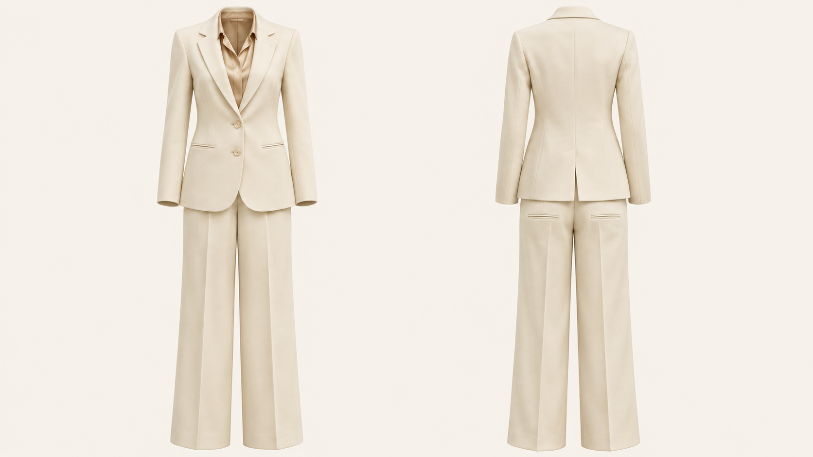
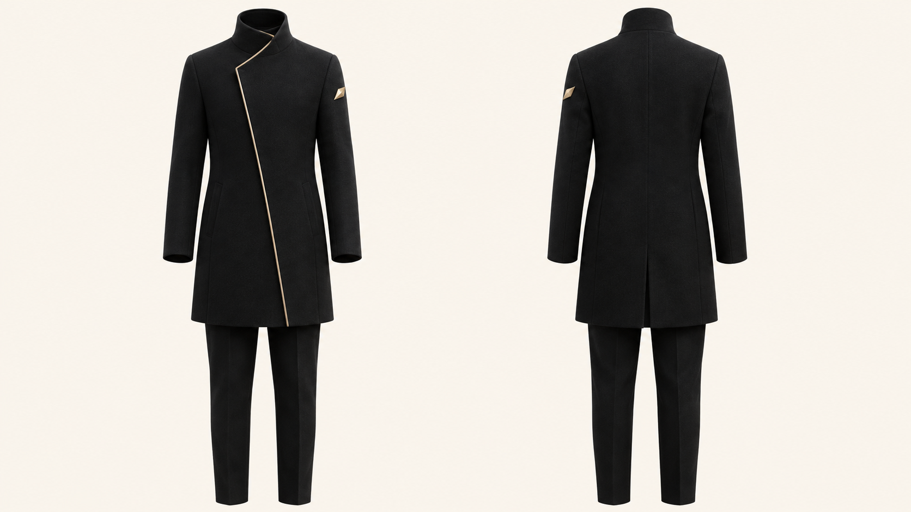
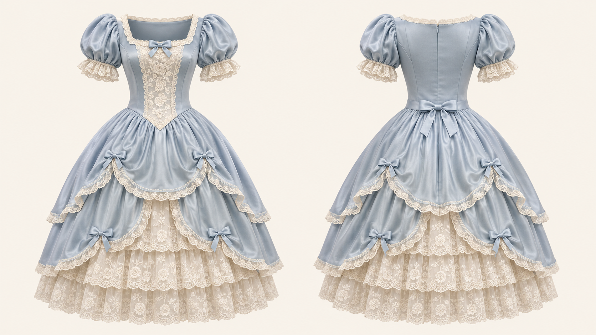

# OutfitTwin
### Reference-guided outfit reconstruction · Front + back, one canvas

[English](README.md) · [简体中文](README.zh-CN.md) · [日本語](README.ja.md)

**OutfitTwin** is an open-source, instruction-only agent skill by **FuturEvoLab**. It turns outfit references into a consistent two-view garment presentation: **front on the left, back on the right, in one 16:9 image**.

The default visual treatment is ghost-mannequin product photography: empty garments with natural volume, a warm ivory background and no visible wearer or support.

> **Status: initial instruction release.** No model weights, API client or image-generation service are included. Image quality depends on the host model and reference evidence. No visual benchmark results are claimed.

## Generated example gallery

Original AI-generated concept examples made with the built-in image-generation tool on 2026-11-03. These illustrate the intended front/back presentation, not extraction accuracy against reference photographs. Native files are 1672 × 941 px (approximately 16:9), preserved without resizing or cropping. The exact backend model was not exposed by the tool. [Prompts and review notes](examples/README.md).

### Ivory tailoring



### Black & gold asymmetry



### Powder-blue Rococo



## What makes it different

| Capability | Behavior |
| --- | --- |
| Whole-outfit reconstruction | Preserve the relationship between outerwear, inner layers, lower garments and relevant accessories. |
| Shared front/back construction | Define one garment specification before producing two views. |
| Evidence-aware completion | Distinguish visible details, structural continuation and newly designed regions. |
| Cropped-reference completion | Extend one-piece garments or coordinate missing lower garments without changing the visible design. |
| Asymmetry handling | Track garment-relative sides across a 180-degree rotation instead of mirroring the front. |
| Targeted repair | Correct the faulty view or region while retaining correct details. |

## Default output

- One landscape **16:9** image; exactly two complete views.
- Left: straight-on front. Right: straight-on rear of the **same outfit**.
- Equal scale, vertical alignment and camera/lighting conditions.
- Uniform warm ivory background, visually close to **#F7F4EC**.
- No person, mannequin, hanger, stand, added labels or watermark.
- Original legible garment marks retained; front-only graphics are not copied onto the rear.

The output is a **2D visualization with a three-dimensional appearance**, not a 3D mesh, sewing pattern or manufacturing specification.

## Quick start

### Use in an image-capable assistant

1. Open [SKILL.md](SKILL.md) and provide its instructions to your assistant, or install this repository as a skill using your host's supported mechanism.
2. Supply the outfit reference. Include a rear reference if available.
3. Request:

> Use OutfitTwin to reconstruct this outfit in one 16:9 image: front left, back right, no wearer, warm ivory background. Preserve the visible design and conservatively complete unseen construction.

4. Review the result using the [visual checklist](references/quality-checklist.md). Ask for a local repair if a feature is wrong.

A Markdown file alone does not grant an assistant image-generation tools. If the host is text-only, the skill returns an English editing prompt.

### Use from a local checkout

```sh
git clone https://github.com/FuturEvoLab/outfit-twin.git
```

Point your agent at `outfit-twin/SKILL.md`, or copy the complete skill folder to the directory your agent supports. Preserve the relative `references/` paths. Host-specific installation and automatic triggering may differ.

### Model integration

GPT Image editing workflows are an intended use case, including user environments that expose GPT Image 2.5. The repository does not select, provision or call a model. Configure an available image-editing model in your host and follow its current documentation. Do not assume that writing a model name in a prompt switches the backend.

Ask the host for an actual 16:9 output size. If unavailable, use supported canvas extension/padding without stretching clothing, or disclose the limitation. API usage and generation fees are separate from this repository.

## Examples

| Reference | Expected behavior |
| --- | --- |
| Complete outfit, front only | Preserve visible details; propose a conservative rear. |
| Matching front and rear photographs | Use each photograph as evidence for its corresponding view. |
| Upper-body jacket photograph | Reconstruct the jacket and coordinate a restrained lower outfit. |
| Asymmetric dress | Preserve the garment-relative position of its slit or ornament through rotation. |
| Sheer layered outfit | Show cloth layers and empty space, never invented skin. |
| Illustrated costume | Preserve the design language while making garment construction credible. |

See the [editing brief and multilingual requests](references/prompt-template.md). These are textual examples, not measured image-generation results.

## Limits and evidence

A single photograph cannot verify hidden seams, closures, rear ornamentation or unseen lower garments. Those areas are proposals, even when photorealistic. For commercial product documentation, provide actual rear/detail references and verify against the physical garment.

Fine text, complex lace, straps, asymmetric placement and cross-view geometry may still drift. The workflow requests visual checks and focused repairs; it does not guarantee perfect reconstruction. Original generated examples are included below; no source-photo extraction benchmark is claimed.

## Repository guide

| File | Purpose |
| --- | --- |
| [SKILL.md](SKILL.md) | Canonical agent instructions |
| [agents/openai.yaml](agents/openai.yaml) | Agent UI metadata |
| [construction-rules.md](references/construction-rules.md) | Evidence, layers, asymmetry and materials |
| [quality-checklist.md](references/quality-checklist.md) | Output acceptance and repair |
| [prompt-template.md](references/prompt-template.md) | Editing template and requests |

The English skill is the canonical execution specification. The Chinese and Japanese READMEs describe the same release.

## Contributing

Open an issue or pull request with the reference type, host/model actually used, prompt, observed failure and proposed correction. Share reference/output images only when you have permission. Distinguish documentation improvements from visually tested results; do not label untested changes as benchmarked.

Never commit API keys, credentials or private reference photos. Prefer small, scoped changes that preserve the front-left/back-right contract.

## License and attribution

[MIT](LICENSE) © 2026 FuturEvoLab. The license covers repository content, not third-party reference images, trademarks, model services or generated-output rights. This is an independent community project, not an official OpenAI product. The project is based on the author's garment-reconstruction specification; it does not bundle third-party skill code.
