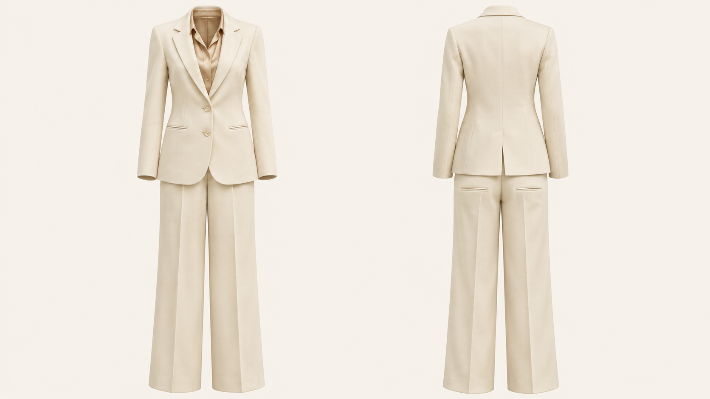
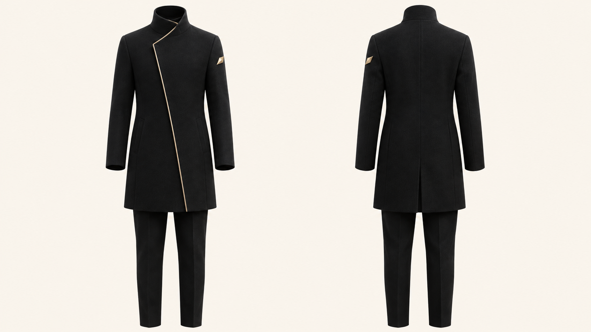
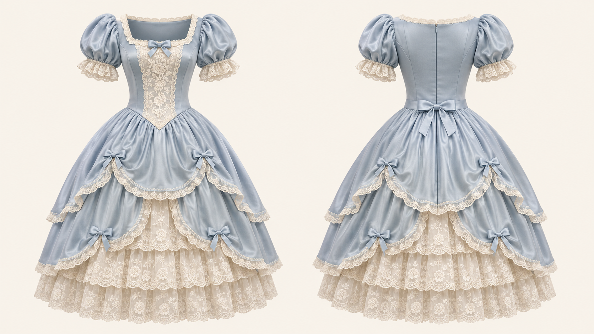

# OutfitTwin｜双面穿搭重建
### 基于参考图的完整服装重建 · 一张图呈现正面与背面

[English](README.md) · [简体中文](README.zh-CN.md) · [日本語](README.ja.md)

**OutfitTwin** 是由 **FuturEvoLab** 发布的开源指令型 Agent Skill。它根据人物穿搭参考图重建独立服装，默认输出**一张 16:9 横向图片：左侧正面，右侧为同一套服装的背面**。

采用隐形模特商品摄影风格：服装保留自然立体体积，背景为暖米白色，不显示人物、人台或支撑装置。

> **当前状态：首版指令发布。** 本项目不包含模型权重、API 客户端或出图服务。实际画质取决于运行环境中的图像模型与参考素材；目前不宣称已完成图像效果基准测试。

## AI 生成示例画廊

以下为 2026-11-03 使用内置图像生成工具制作的原创概念样例，展示预期的正背面排版，并非参考照片提取准确率测试。原始图片为 1672 × 941 像素（接近 16:9），保留原图，未缩放或裁切。工具未返回确切的后端模型名称。[完整提示词与检查记录](examples/README.md)。

### 奶油白通勤套装



### 黑金非对称外套



### 蓝白洛可可裙装



## 核心特点

| 能力 | 执行方式 |
| --- | --- |
| 完整穿搭重建 | 保留外套、内搭、下装与相关配件的层次关系。 |
| 正背面共同结构 | 先确定同一套版型、长度、材质与连接关系，再生成两个视角。 |
| 按证据补全 | 区分原图可见信息、结构延续和新增推断设计。 |
| 半身图补全 | 延续连体服装，或为缺失下装提供克制、协调的搭配。 |
| 非对称设计处理 | 跟踪服装自身左右侧，避免把正面镜像当作背面。 |
| 局部返修 | 优先修复错误视角或区域，保留已经正确的设计。 |

## 默认输出规范

- 单张 **16:9** 横图，仅含两个完整视角。
- 左侧标准正面，右侧为**同一套服装**的标准背面。
- 两侧比例、垂直位置、相机和灯光条件统一。
- 纯净暖米白背景，视觉接近 **#F7F4EC**。
- 无人物、人体模型、衣架、底座、额外标签或水印。
- 保留原服装可识别文字；不将仅属于正面的图案复制到背面。

输出是**具有三维观感的二维图像**，不包含可编辑三维网格、裁剪纸样或生产工艺文件。

## 快速使用

### 在具备图像编辑能力的助手中使用

1. 打开 [SKILL.md](SKILL.md)，将其作为助手的任务指令，或按运行环境支持的方法安装整个 Skill。
2. 上传穿搭参考图；若有背面图，请一并提供。
3. 输入：

> 用 OutfitTwin 提取并重建这套完整服装。一张 16:9 图片，左侧正面、右侧背面，无人物，暖米白背景。保留原图可见设计，不可见部分保守补全。

4. 按[质量检查表](references/quality-checklist.md)核对结果；发现错误时要求局部修正。

单独提供 Markdown 文件不会让助手自动获得图像生成能力。仅支持文本的环境会输出一条英文图像编辑提示词。

### 从仓库使用

```sh
git clone https://github.com/FuturEvoLab/outfit-twin.git
```

让 Agent 读取 `outfit-twin/SKILL.md`，或将完整 Skill 文件夹复制到该 Agent 支持的技能目录。请保留 `references/` 的相对路径。不同宿主的安装方式与自动触发机制可能不同。

### 图像模型与费用

项目面向 GPT Image 图像编辑流程，也可用于开放 GPT Image 2.5 的用户环境。但它本身不配置、不提供、不调用模型。请在宿主中选择实际可用的图像编辑模型，并遵循当前接口文档。提示词写了模型名称，不代表后端已切换。

尽量通过宿主指定实际 16:9 尺寸。若不支持，应使用可用的画布扩展或留白方式，避免拉伸服装，并说明限制。模型 API 与出图费用不包含在本仓库中。

## 典型场景

| 参考素材 | 预期处理 |
| --- | --- |
| 仅有完整正面穿搭 | 保留可见细节，背面采用保守推断。 |
| 同一套衣服的正背面图 | 各自作为相应视角的直接依据。 |
| 只有上半身夹克图 | 重建夹克，补全协调且简洁的下装。 |
| 非对称连衣裙 | 开衩或装饰在旋转后保持服装自身方位。 |
| 透视、多层面料 | 表现织物叠层和内部空腔，不生成皮肤。 |
| 动漫或游戏服饰 | 保留原设计语言，同时使结构合理。 |

[提示词模板](references/prompt-template.md)提供英文编辑指令及中英日使用示例。这些是文本示例，不代表已经实测的出图结果。

## 能力边界

单张图片无法验证隐藏缝线、闭合结构、背部装饰或不可见下装。即使生成结果非常逼真，这些部分也仍属于合理推断。用于真实商品展示时，应补充实物背面与细节图并进行核对。

细小文字、复杂蕾丝、细带、非对称位置与正背面结构仍可能出现偏差。检查与返修流程不能保证百分之百还原。已附原创生成样图；不宣称已完成参考照片提取的视觉基准验证。

## 文件说明

| 文件 | 用途 |
| --- | --- |
| [SKILL.md](SKILL.md) | 英文核心执行指令 |
| [agents/openai.yaml](agents/openai.yaml) | Agent 展示元数据 |
| [construction-rules.md](references/construction-rules.md) | 证据、结构、层次与材质规范 |
| [quality-checklist.md](references/quality-checklist.md) | 输出检查与返修规则 |
| [prompt-template.md](references/prompt-template.md) | 编辑模板与三语使用示例 |

英文 Skill 是统一的执行规范；中文和日文 README 说明同一版本的功能与限制。

## 参与改进

欢迎提交 Issue 或 Pull Request。请注明参考图类型、实际使用的模型与宿主、提示词、观察到的问题及修改建议。仅上传有权分享的素材；明确区分文档修改和经过实际出图验证的改进。

不要提交 API 密钥、登录信息或私人参考照片。建议围绕具体问题修改，保留默认的“左正面、右背面”约定。

## 许可证与署名

[MIT 许可证](LICENSE) © 2026 FuturEvoLab。许可证适用于仓库内容，不涵盖第三方图片、商标、模型服务或生成结果的权利。本项目是独立社区项目，并非 OpenAI 官方产品。内容基于作者的服装重建规范整理，不包含第三方 Skill 代码。
