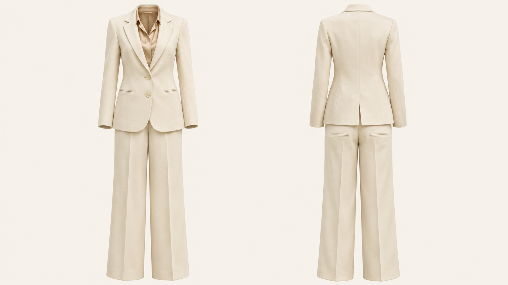
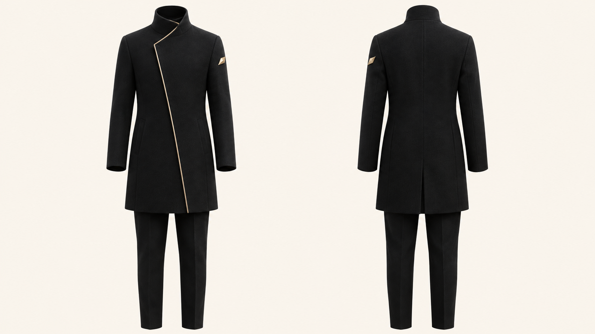
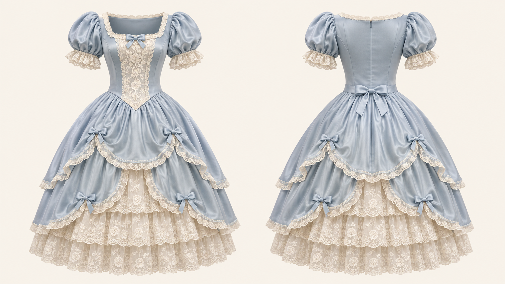

# Generated examples / 生成示例 / 生成サンプル

[English](../README.md) · [中文](../README.zh-CN.md) · [日本語](../README.ja.md)

## Provenance

- Created: 2026-11-03.
- Method: built-in image-generation tool, text-to-image, one call per example.
- Input photographs: none. These are original synthetic concepts, not before/after extractions.
- Exact backend model: not returned by the tool; no model-specific performance claim.
- Native dimensions: 1672 × 941 pixels, approximately 16:9 (not mathematically exact). Originals retained; no resampling, cropping or retouching.
- Review: visually inspected for two views, front-left/rear-right orientation, empty garments, complete framing and broad cross-view consistency. No physical garment or 3D geometry verification.
- Reproducibility: prompts below are exact generation briefs; different runs may produce different details.

中文：三张均由文字直接生成，无人物参考输入，不代表服装提取前后对比或准确率测试。保留原始尺寸；已检查画面方向、无人物状态及整体结构，但没有实物核验。

日本語：3枚ともテキストから直接生成したもので、人物の参考画像は使用していません。抽出の前後比較や精度評価ではありません。元の寸法を維持し、向き、人物の除去状態、全体の構造を目視確認しましたが、実物との照合はしていません。

## Ivory tailoring / 奶油白通勤套装 / アイボリーのテーラードスーツ



### Exact prompt

```text
Use case: product-mockup. Create one premium photorealistic garment catalogue image, EXACT 16:9 landscape canvas. Exactly two equally sized FULL OUTFIT ghost mannequin views, left is straight-on front, right is straight-on rear of the SAME clothing rotated 180 degrees, not a mirrored front. No humans, skin, head, hands, feet, mannequin, transparent human shell, hangers or stands. Empty hollow openings and physically credible fabric volume. Both views match garment lengths, cut, fabrics and layering, vertically aligned with generous margin and central gap. Uniform warm ivory #F7F4EC background, soft diffuse studio light, fine textile detail. No text, logos, labels, borders or watermarks. Entire clothing inside frame. Cream ivory tailored women's pantsuit: softly structured single-breasted two-button blazer, notched lapels, two front welt pockets; pale sand silk blouse visible through front opening; wide straight-leg matching ivory trousers, pressed crease. Back of blazer plain with center seam and discreet center vent, no front lapels or buttons repeated behind. Trousers have realistic rear welt pockets. No shoes. Restrained luxurious wool crepe and silk texture.
```

### Review notes

Front includes lapels, buttons and blouse; rear has a distinct plain back and vent. No visible wearer or support. Trouser width, pockets and folds should be treated as generated design choices, not measured tailoring.

## Black & gold asymmetry / 黑金非对称外套 / ブラック＆ゴールドの非対称コート



### Exact prompt

```text
Use case: product-mockup. Create one premium photorealistic garment catalogue image, EXACT 16:9 landscape canvas. Exactly two equally sized FULL OUTFIT ghost mannequin views, left is straight-on front, right is straight-on rear of the SAME clothing rotated 180 degrees, not a mirrored front. No humans, skin, head, hands, feet, mannequin, transparent human shell, hangers or stands. Empty hollow openings and physically credible fabric volume. Both views match garment lengths, cut, fabrics and layering, vertically aligned with generous margin and central gap. Uniform warm ivory #F7F4EC background, soft diffuse studio light, fine textile detail. No text, logos, labels, borders or watermarks. Entire clothing inside frame. Black contemporary tailored coat outfit with matching slim black trousers. High stand collar, asymmetric diagonal front closure, one thin champagne-gold diagonal trim following the front opening. A single small angular gold ornament fixed on the GARMENT'S LEFT upper sleeve, appearing screen-right in front and screen-left in rear. The rear coat is clean black with a subtle center seam and lower center vent, no diagonal front closure or front trim copied onto rear. Both sleeves same length, straight coat hem at mid thigh. Fine matte black wool, restrained brushed metal accents, no armor, no shoes.
```

### Review notes

The single upper-sleeve ornament appears on screen-right in the front and screen-left in the rear. The diagonal front trim is not copied onto the back. Minor seam and fold differences remain generative details.

## Powder-blue Rococo / 蓝白洛可可裙装 / パウダーブルーのロココ調ドレス



### Exact prompt

```text
Use case: product-mockup. Create one premium photorealistic garment catalogue image, EXACT 16:9 landscape canvas. Exactly two equally sized FULL OUTFIT ghost mannequin views, left is straight-on front, right is straight-on rear of the SAME clothing rotated 180 degrees, not a mirrored front. No humans, skin, head, hands, feet, mannequin, transparent human shell, hangers or stands. Empty hollow openings and physically credible fabric volume. Both views match garment lengths, cut, fabrics and layering, vertically aligned with generous margin and central gap. Uniform warm ivory #F7F4EC background, soft diffuse studio light, fine textile detail. No text, logos, labels, borders or watermarks. Entire clothing inside frame. Original powder-blue and ivory Rococo-inspired modest full dress with a fitted square-neck bodice, short puff sleeves trimmed in ivory lace, layered bell-shaped knee-to-calf length skirt, ivory lace underskirt and small blue bows distributed symmetrically. Front has one ivory central lace panel and a small pale-blue neckline bow. Back has a simple concealed center zipper and one restrained matching waist bow, no front lace panel copied behind. Matching skirt layers and lengths in both views. Finely woven satin with subtle sheen and detailed lace, elegant fashion product, no shoes or accessories.
```

### Review notes

The front lace panel and neckline bow differ appropriately from the rear zipper and waist bow. Layered skirts and puff sleeves remain visually coordinated. Fine lace, bow placement and pleat geometry are illustrative rather than a manufacturing specification.
